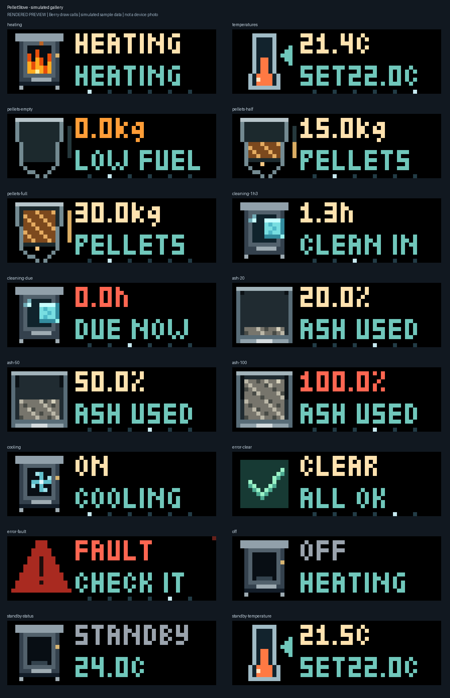

# PelletStove for AWTRIX NG / TC002

Paste [PelletStove.ax](PelletStove.ax) into the TC002's AWTRIX NG Scripts editor. This is a standalone **52 × 16 Berry display app** fed by MQTT, similar to SolarApp. It uses the Haas+Sohn Homey device's existing capability values. No changes to the Homey driver or stove firmware are needed.

The app subscribes only; it never controls the stove or publishes MQTT. The separate [Haas+Sohn Homey app](https://github.com/shaarkys/com.haassohn.pellets) reads the stove over its local API; your Homey MQTT Flow action provides the bridge to the display.

## Views and behavior

While the stove is **turned on** and its mode is **not standby**, the default rotation is **stove → temperature → pellets → cleaning → ash limit → error state**, five seconds per available view. A measurement page appears after its first accepted reading. Missing readings show `--` or `UNKNOWN`, rather than zero or an assumed clear error.

| View | Display and animation |
| --- | --- |
| Stove | Filled stove body with animated fire only when `stove_status` is true, updates are enabled, and mode is not cooling. Fresh `cooling` mode shows a spinning blue fan inside the window instead of flames, even if an older status still says true. Top row: `HEATING` for confirmed heating, otherwise `ON` for confirmed power. Bottom row: MQTT mode, shortened if needed. |
| Temperature | Thermometer, current room temperature on top, target below as `SET22.0C`. A cyan arrow points at the target level; the fill represents actual temperature. Input and displayed units are Celsius. |
| Pellets | Remaining kg, a shaded hopper and a vertical level bar. The default capacity is **30 kg: 0 kg empty, 15 kg half full, 30 kg full**. The picture clamps at full, while the number remains the actual value. Falling pellets appear while heating. |
| Cleaning | Remaining hours and a small cyan microfiber cloth wiping back and forth over the pellet stove face. Specks disappear behind the wipe and a clean-glass glint appears. **Below 1 hour**, the value blinks red once per second and the stove/cloth graphic blinks with it. Exactly 1 hour stays steady. Zero shows `DUE NOW`. |
| Ash limit | Percent of the ash limit **used**, represented by an ash tray. Higher usage produces a deeper textured ash bed and more soot on the walls; 0% is clean and 100% full. This is a visual scale for the reported usage, not a measurement of ash weight. **Above 90%**, the value blinks red once per second and the graphic blinks with it. Exactly 90% stays steady; 100% is due. |
| Error | `CLEAR / ALL OK` with a green check when false; `FAULT / CHECK IT` with a pulsing warning triangle when true. A valid false also cancels queued fault alerts and resets their reminder. This is a Boolean fault indication, not an error-code decoder. |

Animation uses elapsed milliseconds, so its speed does not depend on the draw frame rate. Artwork is drawn by the script; no external icons or GIF downloads are required. Select advances to the next view; left/right keep their normal firmware navigation.

Urgent blinking is 500 ms on / 500 ms off, independent of animation speed and the configurable early-warning thresholds. The descriptive label remains visible during blinking. Stale readings show `-- / STALE` steadily. Crossing either urgent threshold also queues that view with higher priority than an ordinary warning.

**Power and standby gates:** `onoff` and `stove_mode` are always monitored. A valid **false** error reading is also always accepted to retire an old fault, even before either control arrives. The current room temperature continues updating during standby while power and mode are fresh and power is **true/Yes**. Every other measurement normally requires a fresh non-standby mode (case-insensitive, surrounding whitespace ignored). The optional standby-skip setting below also monitors the target temperature. Missing, expired, or false power closes the gate. A non-standby mode alone never implies power is on. Other mode names, including `off`, are allowed only if the separate power reading is true.

When power is false, only `OFF` and the latest usable mode are shown. Power true with standby shows **`STANDBY` on top and the current temperature below**, for example `24.0C`. This ordinary standby page remains available when the separate temperature page is disabled. Other measurement/fault pages stop rotating, and the flame stops. A missing current temperature shows `--`; an expired reading shows `STALE`, never a stale number presented as current. `POWER? / NO DATA` means the new required power topic has not arrived; `POWER? / STALE` means it expired. Missing/expired mode with power on shows `MODE? / NO DATA` or `STALE`.

The cooling fan follows the fresh reported `cooling` phase. It can therefore remain animated on `OFF / COOLING` while measurement pages are hidden, reflecting the reported cooldown phase. It is an illustration of that phase, not a measured fan speed. Cooling never shows flames or falling pellets; a stale cooling mode stops the fan.

Closing either gate freezes measurement values/timestamps internally and marks them expired, except current temperature during powered-on standby, target temperature monitored with the optional standby setting, and explicit false error readings. On resuming, a new reading is required for expired values. A previously accepted fault is retained internally and, once the gates reopen, can appear as `FAULT / STALE` until a valid false is received. `STALE` means the display lacks a fresh accepted error reading; it does not mean Homey currently reports a fault. A false received while OFF/standby clears the stored fault and its reminder without opening measurement pages. The clear itself can become stale while gated, so a fresh error reading is still required for a confirmed `CLEAR / ALL OK` page after resuming. While OFF/paused even the fault page is hidden. On restart, values start unknown; the app does not persist old stove readings.

### Optional: skip standby except temperature changes

Enable **Skip standby except temperature changes** in the script's **Display** settings. Its default is **Off**, showing the ordinary `STANDBY` / current-temperature page. Keep the script enabled in AWTRIX: this option uses the official [`should_show()` hook](https://blueforcer.github.io/awtrix-ng/tc002/guides/scripting/several-apps/) to skip display turns while MQTT callbacks and background monitoring continue. Fully disabling the script would prevent it from detecting the next update.

With fresh **power Yes** and **mode standby**, only current and target temperatures continue updating. The app stays out of rotation until either numerical value changes. At the next available turn it shows **only the temperature page**, for **Seconds for important changes** (default eight seconds), then skips again. Repeated identical readings do not trigger another turn. Multiple changes before a turn are combined into the latest pair of values; a change during that turn queues another temperature turn. Select stays on temperature during these visits.

The first accepted temperature establishes a baseline without triggering a turn. This also means retained readings after a script restart do not create a spurious temperature alert. Keep publishing both temperatures during standby, along with power and mode. **Show actual and target temperature** must remain enabled. A false/missing/expired power input still blocks readings and cancels pending standby turns; expired temperature changes cannot trigger a turn. The normal rotation returns when a fresh non-standby mode arrives. If the app is already visible when standby arrives, AWTRIX finishes its current allotted turn; skipping applies from the next turn. This option does not wake the display or interrupt another AWTRIX app.

Important changes get a longer view, eight seconds by default:

- While both gates are open, a newly accepted fault takes priority at the next script loop (normally within about one second while shown). It repeats every 30 seconds while still true, including a stale last-known fault. A red corner pixel stays visible on other measurement views.
- Power/mode/status changes, target-temperature changes, warning threshold crossings, refills of at least 1 kg, cleaning-counter increases of at least 1 hour, and ash-counter resets of at least 5 percentage points queue the corresponding view. OFF and paused suppress all queued measurement views.
- Non-fault changes wait for the current view to finish. Duplicate/retained messages and small consumption or room-temperature changes do not repeatedly interrupt rotation. Up to one change per view is queued, with faults above due counters, warnings, and ordinary changes.
- Changes received while this app is hidden are queued for its next normal appearance. This script does not interrupt other AWTRIX apps or force the clock on. The requested app duration allows a full normal cycle plus one change hold; a stream of changes may carry queued views into the next appearance.



[Animated rotation](pelletstove-showcase.gif), [cleaning warning](animations/cleaning-due.gif), [ash warning](animations/ash-100.gif), [cooling fan](animations/cooling.gif), and [microfiber cleaning](animations/cleaning-1h3.gif).

These are simulated previews from the script's actual Berry drawing calls, with sample MQTT data and the official upstream small font. They are **not recordings or proof from a physical TC002**. The gallery includes 0/15/30 kg hopper levels, ash usage levels, temperature-only standby, and clear/fault states. See [font provenance](../source-notices/FONT-NOTICE.md) and the [media guide](../MEDIA.md).

## 1. Install the script on the TC002

1. Open the TC002's AWTRIX NG web UI. Configure its MQTT connection to the **same broker** used by your Homey MQTT publish Flow action. Keep broker credentials in the device's MQTT configuration, not the script.
2. Open **Scripts**, create a script named `PelletStove`, and paste the complete contents of `PelletStove.ax`. Save it, enable it in the rotation, and use **Show on the clock**.
3. Open the script's generated configuration form. All inputs below are configurable. No other files in this directory need uploading.
4. With no messages, the display says `NO DATA / MQTT`. Both power and mode must arrive before the other values are accepted.

### Updating your existing script and Homey Flow

- Paste the updated source into the same script, then add a MQTT publish action for **`homey/pellet_stove/onoff`**, using your stove's **Turned on** (`onoff`) tag. Publish both Yes and No, including when the stove is off. Keep QoS 1 and retain enabled as in your existing Flow. Without this new required input the script displays `POWER?`.
- Your pellets topic should use the **`stove_pellets_actual`** tag; replace `measure_stove_pellets` in that action if it still uses the older tag.
- Set **Full hopper capacity (kg) to 30** in the script form. A previously saved value of 15 is preserved until you change it; changing the default cannot overwrite your saved setting.
- There are now nine capability topics, but no subscription-limit increase is required: exact topics sharing a parent are grouped automatically, for example `homey/pellet_stove/+`. Each message is still dispatched by its exact topic; unrelated siblings are ignored. Explicit custom wildcard topics are also supported. If your custom paths require more than eight distinct subscription filters, setup logs an error and subscribes to none; use the combined JSON topic or group the parent paths.

This follows the official [TC002 scripting guide](https://blueforcer.github.io/awtrix-ng/tc002/guides/scripting/), [MQTT subscription API](https://blueforcer.github.io/awtrix-ng/tc002/guides/scripting/network/), and [drawing API](https://blueforcer.github.io/awtrix-ng/tc002/guides/scripting/drawing/).

## 2. Publish values from Homey Flows

Use the **same MQTT publish action you already use for SolarApp**. The following topic names are proposed defaults for this new setup, not topics already published by the Haas+Sohn app. Replace the prefix if you prefer, and set exactly matching topics in the script form. You do not publish them to an AWTRIX `/custom` topic.

| Script setting | Default MQTT topic | Homey capability / payload example |
| --- | --- | --- |
| Turned on MQTT topic (Yes/No) | `homey/pellet_stove/onoff` | `onoff`: `true` / `false`, `Yes` / `No` |
| Mode MQTT topic | `homey/pellet_stove/stove_mode` | `stove_mode`: `heating` or `standby` |
| Heating MQTT topic | `homey/pellet_stove/stove_status` | `stove_status`: `true` / `false` |
| Actual temperature MQTT topic (C) | `homey/pellet_stove/measure_temperature` | `measure_temperature`: `21.4` |
| Target temperature MQTT topic (C) | `homey/pellet_stove/target_temperature` | `target_temperature`: `22` |
| Pellets MQTT topic (kg) | `homey/pellet_stove/stove_pellets_actual` | `stove_pellets_actual`: `8.4` |
| Cleaning MQTT topic (hours) | `homey/pellet_stove/measure_stove_cleaning_in` | `measure_stove_cleaning_in`: `32.5` |
| Ash limit MQTT topic (% used) | `homey/pellet_stove/measure_stove_maintenance_in` | `measure_stove_maintenance_in`: `45` |
| Error MQTT topic | `homey/pellet_stove/stove_error_state` | `stove_error_state`: `false` |

### Simple scheduled Flow

Create a scheduled Homey Flow, for example once per minute, that reads your stove's **current capability values** using the value/tag mechanism you already use, and sends the nine MQTT messages above. Put current values in the payload fields as tags. Use decimal points and no unit suffixes: `8.4`, not `8,4 kg`.

Boolean inputs (`onoff`, `stove_status`, `stove_error_state`) accept true/false, 1/0, Yes/No and On/Off, ignoring case and surrounding whitespace. Literal `✓`, `✔`, `✅` are true; `x`, `×`, `✕`, `✖`, `✗`, `✘`, `❌` are false. In particular, the paired crosses `✗`/`✘` clear a previously true fault. If your MQTT viewer uses a cross merely to display a JSON false, that false works too. A mode word such as `Heating` is not a Boolean; the script does not guess power from it.

When a valid false is accepted after a true error, the script logs `PelletStove: fault cleared` and removes the old fault's priority/reminder. With both display gates open, it immediately changes a visible error page to `CLEAR / ALL OK`; if the clear-error view is disabled, it exits that page immediately. A false received while OFF/standby, with expired controls, or before the controls arrive also clears the stored fault. It does not expose measurement pages or reopen the gates. A missing or invalid error reading never silently clears an old true fault. New true error readings still require both gates to be open.

**Send power and mode first, then the other seven messages.** If your Flow runs actions concurrently, use the combined JSON option below so the script evaluates both controls and readings atomically. Continue publishing power, mode, and the current error Boolean while off or in standby, so the display can detect resuming and receive fault clearance. Optional Flow conditions can suppress other traffic while power is false or mode is standby. Always keep the current-temperature action publishing during standby; also publish the target temperature if you enable standby temperature turns. The script enforces its input gates itself too.

If your publisher supports retained messages, enable retention so readings are available after a display restart. Separate retained topics can arrive in any order: measurements arriving before usable power and mode are ignored, except an explicit false error reading; the next scheduled refresh supplies the other readings again. There can similarly be a refresh-cycle delay when resuming from OFF/standby. A single retained JSON snapshot avoids that ordering problem.

For faster updates, the app already has these specific triggers:

| Homey WHEN card | Token to publish | Destination |
| --- | --- | --- |
| Pellets amount changed | `pellets_kg` | pellets topic |
| Cleaning changed | `cleaning_hours` | cleaning topic |
| Ash limit changed | `ash_limit_percent` | ash topic |
| Stove error detected | Literal `true` | error topic |

Keep the scheduled refresh for power, mode, both temperatures, status, and fault clearance. The referenced Homey app does not define a separate mode/status change card or a fault-cleared card in the input-contract revision recorded here. The error-detected event alone **cannot clear a fault**: also publish the current `stove_error_state`, including false, regardless of mode/power. New true fault events while OFF/standby are ignored, as requested; explicit false clears an older stored fault. A Homey device export confirms Homey's value, but does not prove what was published to MQTT or received by AWTRIX. Homey's capability `lastUpdated` is not the script's MQTT-receipt timestamp. The temperature readings are the Homey capabilities `measure_temperature` (room temperature) and `target_temperature`, not exhaust or stove-body temperature.

### Optional: one JSON snapshot (recommended for ordered mode gating)

Set **Combined JSON topic** to, for example, `homey/pellet_stove/state`. The script then subscribes **only to this topic** and ignores individual-topic subscriptions, keeping within AWTRIX's eight-subscription limit. Publish the structure in [example-state.json](example-state.json), replacing the examples with current values:

```json
{
  "onoff": true,
  "stove_mode": "heating",
  "stove_status": true,
  "measure_temperature": 21.4,
  "target_temperature": 22,
  "stove_pellets_actual": 8.4,
  "measure_stove_cleaning_in": 32.5,
  "measure_stove_maintenance_in": 45,
  "stove_error_state": false
}
```

Keys are the exact capability IDs. Power and mode are processed first regardless of JSON key order. A snapshot whose power is false updates only those controls and an explicit false error reading. With power true, a standby snapshot accepts current temperature regardless of the skip setting, and target temperature when standby-skip is enabled. Missing fields preserve their previous values and timestamps; invalid fields do not become zero. Top-level fields may also use `{"value": ...}` envelopes. Scalar topics accept plain values, JSON primitives, or `{"value": ...}`. Numeric strings are accepted; invalid values are logged without printing the payload. Send only one stove per configured topic/filter. This JSON structure uses top-level capability keys, not the full Homey device-export structure containing `capabilitiesObj`.

## 3. Set display preferences

| Setting | Default | Meaning |
| --- | --- | --- |
| Seconds per view | 5 | Normal dwell, 2–30 seconds. |
| Seconds for important changes | 8 | Changed/warning view dwell, 2–30 seconds. |
| Repeat active error | 30 | Reminder period, 15–300 seconds. |
| Animation speed | 4 | 1–10. |
| Full hopper capacity | 30 kg | 0 kg empty, 15 kg half, 30 kg full. Scales the fill and level bar. Previously saved settings remain until changed. |
| Low pellets warning | 3 kg | Warning at or below this value. |
| Cleaning warning | 5 h | Early warning at or below this remaining time. The fixed urgent blink starts below 1 h. |
| Ash limit warning | 80% | Early warning at or above this **used** percentage. The fixed urgent blink starts above 90%. |
| Reading timeout | 0 | No expiry, useful for change-only Flows. With one-minute refreshes, use 180 seconds. |
| Show pellets / cleaning / ash / temperature | On | Disable unwanted pages. Their inputs can still be received. |
| Show error state when clear | On | Hide the clear-error page if desired. A last-known true fault remains eligible while both gates are open. |
| Skip standby except temperature changes | Off | Skip standby turns; with power Yes, a changed current or target temperature allows one temperature-only turn. MQTT stays active. |

An empty individual MQTT topic disables that input's subscription, but power and mode are required for measurement views. The ordinary standby page shows current temperature; the optional standby temperature turn can show both temperatures. Power Yes is always required for either. Fault clearance is accepted independently of these display gates. Timeouts measure time since the script **received** the value, not time since the stove measured it. A retained message can be old when received; the publisher is responsible for keeping retained state current. With timeout `0`, values can remain old indefinitely between updates while the gates stay open, which is intentional for change-only Flows.

**Unit boundary:** use Homey capability values, not raw stove API fields. The separate Homey driver converts raw `cleaning_in` minutes to hours and raw `maintenance_in` to an inverted ash-usage percentage. Do not divide hours again or invert the capability percentage. The target range is the driver's 5–35°C; the display accepts actual temperatures from −40 to 100°C.

## 4. Check on your hardware

1. Run your publishing Flow once with fresh power true/Yes and a non-standby mode. Confirm the six views match Homey, including actual/target temperatures, hours, kg and ash percentage. Heating animation also requires `stove_status=true`. Power Yes + mode cooling + status cross should show `ON / COOLING` with the spinning fan and no fire. Power No shows only `OFF` and the mode, keeping the fan if that fresh mode is cooling.
2. Change the target through your normal Homey controls and confirm the temperature page is brought forward after the current view. Small actual-temperature changes should update the number without repeated preemption.
   The cyan arrow beside the thermometer marks the target. Numeric `--` means no usable value: publish both temperatures after fresh power true and non-standby mode (or in the same JSON snapshot).
3. With the standby option off, confirm mode standby shows `STANDBY` and a live current temperature while other measurement pages stay hidden and the flame stops. Power No must hide and stop accepting temperature readings too. On resuming, confirm fresh readings are needed. Then enable **Skip standby except temperature changes**: with power Yes and standby, publish an unchanged temperature pair and confirm no display turn; change either temperature and confirm one temperature-only turn, followed by skipping. Repeating that pair should not trigger another turn. Power No must still block it. Use isolated test topics for simulated transitions; no need to change the physical stove just to test a display.
4. For an isolated MQTT display test, configure a separate test topic in the script and send sample JSON there. Check an introduced true fault, its repeat, and an explicit false (or `✗`) with power true and non-standby mode. The script log should say `fault cleared`; the page should show `CLEAR / ALL OK`, with no repeating red fault. Also check a true fault followed by OFF/standby, then false before resuming: the old fault must not return after the gates reopen. Republish false after resuming to confirm `CLEAR / ALL OK`. Then restore your production input topic. Do not send test commands to the stove's own control topics.
5. With timeout 180, stop only the test publisher: after three minutes the expired power/mode hides measurement views and the first page shows `POWER? / STALE`. If you keep controls refreshed but stop one metric, its page should show `-- / STALE` (a retained true fault instead stays `FAULT / STALE`). Restore the publisher and verify recovery.
6. On isolated test topics with power Yes and non-standby mode, check cleaning at `1` h is steady and `0.9` h blinks; ash at `90`% is steady and `90.1`% blinks. Also check pellets at `0`, `15`, `30` kg show an empty, half and full hopper with the capacity set to 30. Blinking is half a second visible, half a second hidden; the page label stays visible.

## Local verification and limitations

The script has been exercised in a **Berry 1.1 VM with mocked AWTRIX drawing/MQTT/time APIs**. This checks parsing, power/standby gating, temperature-only standby turns and their consumption, grouped MQTT routing, units, priorities, rotation, staleness, integer hopper levels, proportional ash/soot, drawing bounds and frame-rate-independent animation. It does not prove physical TC002 rendering, firmware API integration, broker delivery, or Homey Flow configuration.

From `PelletStove/`, with a Berry 1.1 interpreter and Python installed (the full repository build is described in the [root guide](../README.md)):

```powershell
& $env:BERRY tools/test_pelletstove.be
python tools/verify.py
```

Optional preview regeneration requires Pillow (`PIL`) in your Python environment:

```powershell
python tools/render_preview.py
```

The Berry test writes `tools/preview-frames.json`, `tools/progress-frames.json`, `tools/cooling-frames.json` and `tools/cleaning-frames.json` (ignored by Git). The renderer consumes them to create the PNG/GIF previews. Font data and its license/provenance live in `../source-notices/`; they are not dependencies of the clock script. No npm production dependencies, Homey capability migrations, manifest edits, or Homey build changes are required.

The input checks use the committed `input-contract.json` snapshot. They do not need a neighboring Homey repository. The source script includes the live current-temperature standby page, the optional temperature-change standby turns, and the correction that accepts explicit fault clearance while display gates are closed.
